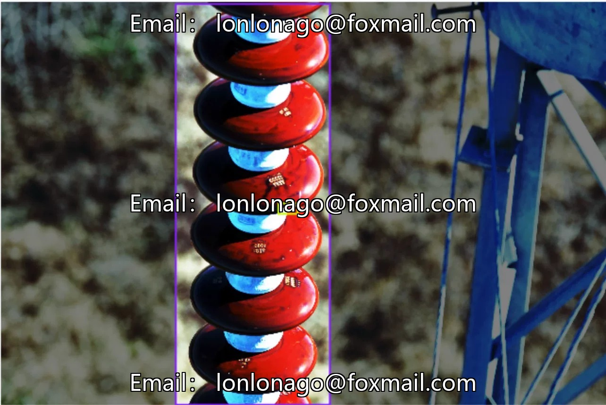
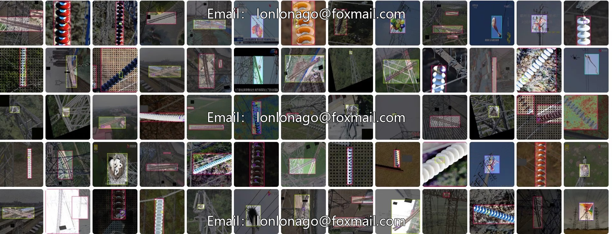
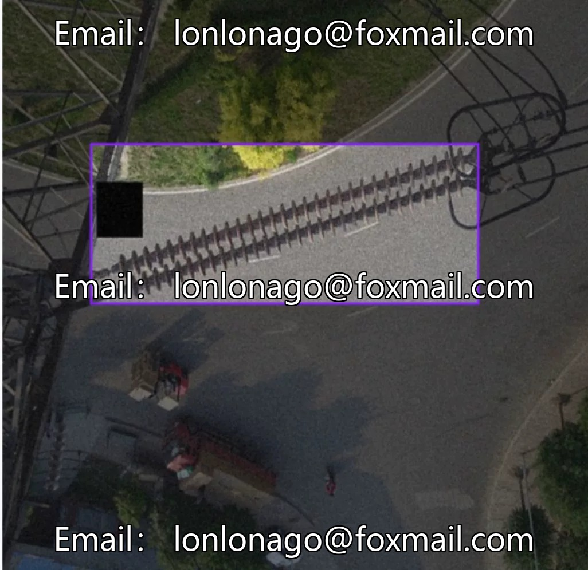
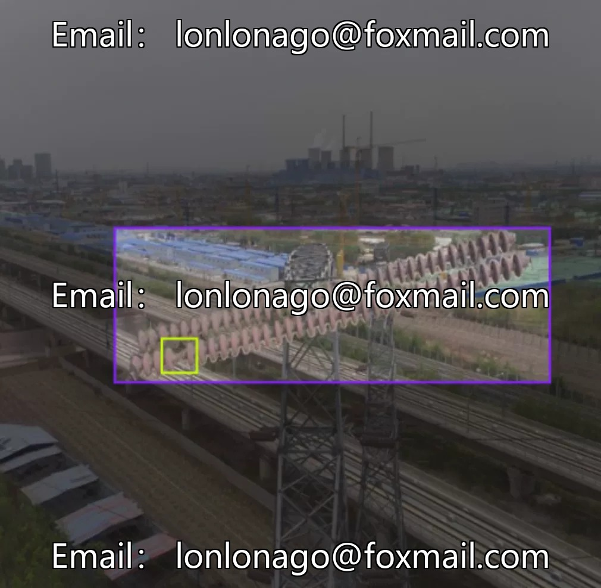
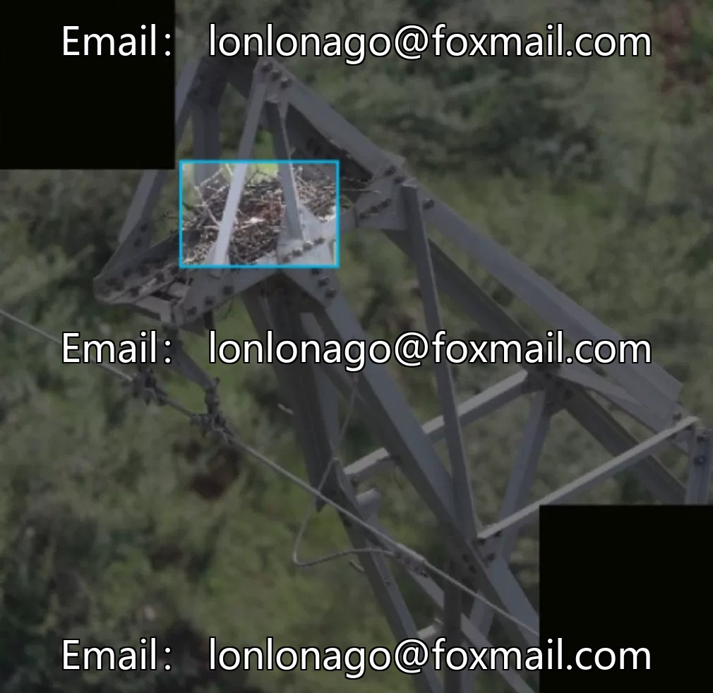

# Drone Power Line Flight Inspection Data Set, 10k images, 5 annotation categories: b

## Body

Drone Power Line Flight Survey Inspection Data Set, 10k images, 5 annotation categories: burst (burst), defect (defect), foreign_obj (foreign object), insulator (insulator), nest (nest). Covers insulator-related scenarios, suitable for external appearance defect detection of power equipment. Supports automated quality inspection, reduces the cost of manual investigation.

The dataset consists of 33 subsets, accompanied by 22 models, supporting multi-round training validation. It is in the format of image files + annotation information, suitable for training target detection models. The data volume is sufficient, the categories are precise, and model development and testing are convenient.

Virtual materials, once sold, are non-refundable.
Interested friends, click "I want" to proceed.

## Images

## Payment

Here is a pay link on Stripe ( https://buy.stripe.com/3cs8yP7sY87d0vu9AB ). Please contact me lonlonago@foxmail.com after funding $89, and I will send you a complete data files , thank you!

